# Eilenberg–Watts correspondence

This repository formalizes the **Eilenberg–Watts correspondence over arbitrary associative unital rings**, together with all 35 reviewed categorical prerequisite results. Tensoring with a bimodule corresponds to an additive functor between module categories preserving finite colimits and arbitrary coproducts in the stated universes; evaluation at the lifted regular module supplies the explicit inverse. Natural transformations correspond to bimodule maps.

The library includes the general universe-polymorphic equivalence, its regular-evaluation formulas, tensor composition and unit compatibility, and the checked original-form correspondence adapter. Start with `import EilenbergWatts`; see [API.md](API.md) for the principal declarations, [BUILD.md](BUILD.md) for reproducible build commands, and [PROVENANCE.md](PROVENANCE.md) for the unchanged source extraction and earlier reviews. All required project sources are included locally, and the only external library dependency is pinned mathlib.

All listed results compiled and passed the axiom audit.

[Article](https://getcurious.cc/downloads/abelian-categories-and-bimodules-lecture-notes.pdf) · [Alphabeta Math](https://getcurious.cc/downloads/abelian-categories-and-bimodules-lecture-notes.pdf)

## Dependency overview

20 landmark definitions and results. Arrows follow dependency paths, with intermediate items omitted. [Full dependency graph](DEPENDENCIES.md) · [Exact proof graph and suppliers](proof-graph.json).

```mermaid
graph TD
  ModuleCategoriesAreAbelian["Module categories are abelian"]
  ModuleProductsAndCoproducts["Products and coproducts of<br/>modules"]
  FreeModulesAndPresentations["Free modules and presentations"]
  RegularModuleSmallProjectiveGenerator["The regular module is a small<br/>projective generator"]
  BalancedTensorUniversalProperty["Construction and universal<br/>property"]
  BimoduleTensorFunctoriality["Induced actions and functoriality"]
  BalancedTensorAssociativity["Associativity with the correct<br/>sides"]
  TensorPreservesCoproducts["Tensoring preserves arbitrary<br/>coproducts"]
  TensorPreservesCokernels["Tensoring preserves cokernels"]
  GeneratorHomFullyFaithful["Morphisms are determined by<br/>module maps"]
  ReconstructionFromSmallProjectiveGenerator["Reconstruction from a small<br/>projective generator"]
  RegularEvaluationRightAction["The two actions on F(R)"]
  CanonicalWattsNaturalTransformation["The canonical natural<br/>transformation"]
  EilenbergWatts["Eilenberg–Watts"]
  NaturalTransformationsByRegularEvaluation["Evaluation at R classifies every<br/>transformation"]
  BimoduleFunctorHomEquivalence["The equivalence of Hom categories"]
  TensorDictionaryCompositionAndIdentities["The tensor dictionary preserves<br/>composition"]
  TensorPentagonAndTriangle["Associativity pentagon and unit<br/>triangle"]
  HorizontalCompositionOfTransformations["Composition of transformations"]
  CategoricalBimoduleDictionary["The complete dictionary"]
  FreeModulesAndPresentations --> GeneratorHomFullyFaithful
  GeneratorHomFullyFaithful --> ReconstructionFromSmallProjectiveGenerator
  TensorDictionaryCompositionAndIdentities --> HorizontalCompositionOfTransformations
  ReconstructionFromSmallProjectiveGenerator --> CategoricalBimoduleDictionary
  BimoduleFunctorHomEquivalence --> CategoricalBimoduleDictionary
```

[Proof dependency graph](proof-graph.json) includes exact Lean suppliers and coverage.

## External proofs

The only external library used is [mathlib](https://github.com/leanprover-community/mathlib4); see the [full list of external proofs](EXTERNAL_PROOFS.md).

## Navigation and verification

- [PROJECT.md](PROJECT.md): statements, sources, translations and dependencies.
- [EXTERNAL_PROOFS.md](EXTERNAL_PROOFS.md): external proof ledger.
- NotesProofs/: Lean declarations and proofs.
- translations/: independently reviewed types and definition values.
- evidence/: reviews, compiler diagnostics and axiom audits.

Run `lake update`, `lake exe cache get`, then `lake build`. The workflow additionally checks each declaration's axioms, permitting only propext, Classical.choice and Quot.sound.
